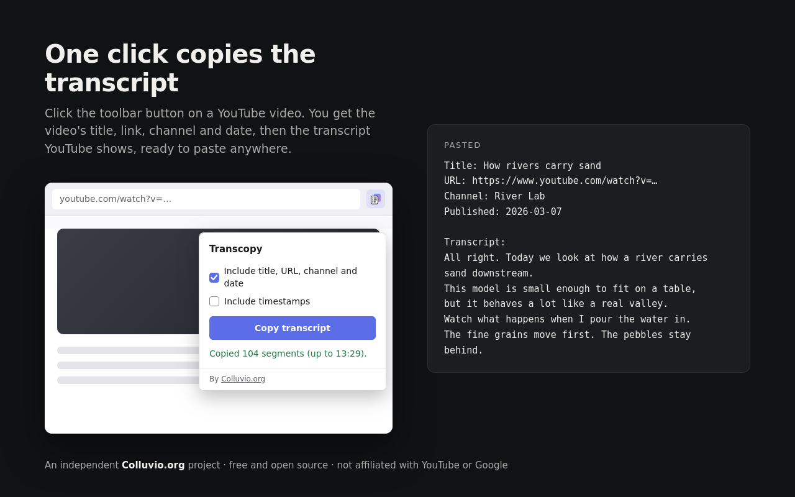

# Transcopy

Transcopy is a free, open-source Firefox extension that copies the transcript YouTube shows for a video to your clipboard: as plain text, or with timestamps.

An independent [Colluvio.org](https://colluvio.org) project. **Not affiliated with, endorsed by or sponsored by YouTube or Google.**



## What it does

1. Open a video on youtube.com.
2. Click the toolbar button (or press <kbd>Alt</kbd>+<kbd>Shift</kbd>+<kbd>T</kbd>).
3. Paste the transcript anywhere: a document, notes, ChatGPT, Claude…

Opening the popup copies straight away, so it is one click. By default the transcript comes under the video's details. With **Include timestamps** ticked you get:

```text
Title: How rivers carry sand
URL: https://www.youtube.com/watch?v=0UPvLfZ6X3Q
Channel: River Lab
Published: 2026-03-07

Transcript:
[00:00] All right. Today we look at how a river carries sand downstream.
[00:07] This model is small enough to fit on a table,
```

Videos over an hour use `[HH:MM:SS]` on every line. Without timestamps you get one segment per line. Untick **Include title, URL, channel and date** to copy the transcript alone. Both choices are remembered.

- **Video details.** The title and channel are the video's original ones, which can differ from the title YouTube shows if it translates titles for you. The date is the publication date YouTube displays, as `YYYY-MM-DD`. The URL is the plain watch URL, without a start time or playlist. A detail the page doesn't provide is left out.

- **The text YouTube displays.** It is read from YouTube's own transcript panel, in the language shown there. Nothing is translated, summarized, rewritten or de-duplicated. Chapter titles and the screen-reader timestamp labels ("1 minute, 8 seconds") are left out.
- **The panel can be closed.** If it is, the extension opens it with YouTube's "Show transcript" button and waits until the full transcript has loaded.
- **Never partial.** If the transcript is missing, fails to load, is still loading, or belongs to the previous video during YouTube's in-page navigation, nothing is copied and the popup says why.
- **Private.** The extension sends nothing anywhere: no server, no analytics, no accounts, no remote code. The only network activity is YouTube's own page loading the transcript after the extension presses YouTube's "Show transcript" button. See [PRIVACY.md](PRIVACY.md).

## Install

- **Firefox Add-ons:** https://addons.mozilla.org/firefox/addon/transcopy/
- **From source (temporary, for testing):** open `about:debugging#/runtime/this-firefox`, choose **Load Temporary Add-on…** and select `extension/manifest.json`. Temporary add-ons are removed when Firefox restarts.

Requires Firefox 140 or later on desktop.

## Limitations

- Works on `youtube.com/watch` pages only. Shorts, embedded players, YouTube Music, `m.youtube.com` and Firefox for Android are not supported.
- Videos without captions have no transcript.
- YouTube's current transcript panel ("In this video", 2025 onwards) has **no language selector** and ignores the captions (CC) language chosen in the player. The extension copies whatever that panel shows, which is usually the video's original or default track. The older panel, which still appears for some users, has a language dropdown; the extension copies whichever language is selected there and shows its name in the status line.
- YouTube sometimes doesn't load a transcript into its panel (for example while an ad is playing). The extension then reports the failure; reloading the page usually helps.
- The extension depends on YouTube's page structure. If YouTube changes it and copying stops working, please [open an issue](https://github.com/colluvio/transcopy/issues).

## How it works

Clicking the button grants the extension temporary access to the current tab (`activeTab`). The popup then injects the scripts in `extension/content/` with `scripting.executeScript`:

| File | Concern |
|---|---|
| `content/detect.js` | Transcript detection: page/video identity, finding the open panel, YouTube's "Show transcript" button |
| `content/segments.js` | Segment extraction for the current (`transcript-segment-view-model`) and older (`ytd-transcript-segment-renderer`) layouts |
| `content/timestamps.js` | Timestamp parsing and normalization |
| `content/metadata.js` | Video details: title, channel and publication date |
| `content/format.js` | Text formatting, including the details header |
| `content/run.js` | Orchestration: open, wait until complete, check for stale or mixed content, extract |
| `popup/clipboard.js` | Clipboard interaction |
| `popup/popup.js`, `popup.html`, `popup.css` | User interface |
| `popup/messages.js` | Error messages |

Findings from testing against YouTube (October 2026, Firefox 158):

- YouTube's transcript panel renders every segment at once. A 3-hour video produced all 1,346 segments, so no scrolling is needed. The extension still waits until the segment count stops changing and no loading indicator remains.
- During in-page navigation YouTube updates the URL first and the page about a second later; for that moment the old video's transcript is still in the DOM. The extension refuses to read until the rendered video matches the URL.
- The video details come from the schema.org `VideoObject` record YouTube keeps inside the watch page (`ytd-watch-flexy #microformat`). It is updated on in-page navigation and names its video, so the extension only uses a record for the video in the URL. The similar record and `<meta>` tags in the page's `<head>` keep describing the first video loaded, so they are never trusted on their own.
- The extension does not call YouTube's internal APIs (such as `get_transcript` or `timedtext`). Those are undocumented, and YouTube rejects requests that its own player hasn't made. Reading the panel the user would see is more reliable and copies exactly what YouTube shows.

## Development

Requirements: Node.js 20+ and Firefox 140+.

```bash
npm ci
npm test            # unit tests (node:test + jsdom fixtures)
npm run lint        # web-ext lint
npm run build       # dist/transcopy-<version>.zip
npm start           # web-ext run: Firefox with the extension, on the test video
npm run test:e2e    # end-to-end in real Firefox against live YouTube (needs `npm run build`)
```

There is no bundler and no build step beyond zipping `extension/`. The icon PNGs and AMO screenshots are rendered with headless Firefox (`npm run icons`, `npm run screenshots`).

- Testing: [docs/TESTING.md](docs/TESTING.md)
- Publishing on addons.mozilla.org: [docs/PUBLISHING.md](docs/PUBLISHING.md)
- Contributing: [CONTRIBUTING.md](CONTRIBUTING.md)

## Mozilla Add-ons

Listed at https://addons.mozilla.org/firefox/addon/transcopy/ (1.0.1). Version 1.0.2 was submitted on 21 October 2026 and is awaiting Mozilla's review. Status is tracked in [docs/PUBLISHING.md](docs/PUBLISHING.md#status).

## License

[MIT](LICENSE) © 2026 Colluvio.org
